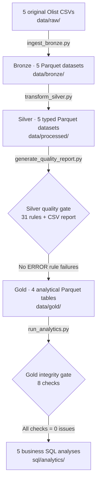

# Retail Data Platform

A reproducible, **locally implemented data engineering and retail analytics project** built with **Python, DuckDB, SQL, and Apache Parquet**. It processes five datasets from the historical Olist Brazilian e-commerce dataset through **Raw → Bronze → Silver → Gold**, runs automated quality and model-integrity checks, and answers business questions using reusable SQL.

> **Implementation status:** the complete local pipeline has been executed successfully. Azure is documented as a potential target architecture; cloud ingestion, orchestration, and compute have **not** been deployed or verified.

## At a glance

| Area | Implemented capability |
|---|---|
| Data ingestion | 5 source CSVs → Bronze Parquet |
| Transformation | 5 typed Silver datasets → 4 analytical Gold tables |
| Data quality | 31 automated rules and a generated CSV report |
| Gold integrity | 8 automated model checks |
| Business analytics | 5 SQL analyses, plus the Gold integrity query |
| Orchestration | One Python command runs all 5 stages in sequence |

## Architecture



`src/run_pipeline.py` runs the five stages in order: **Bronze ingestion → Silver transformation → data-quality validation/reporting → Gold modelling → Gold integrity and business analytics**. The orchestrator stops on a failed stage. Quality warnings are recorded without failing the run.

See [the architecture document](docs/architecture.md) and [the local pipeline guide](docs/local-pipeline.md) for details.

## Technologies

- **Python** — ingestion, transformations, data-quality checks, and orchestration.
- **DuckDB and SQL** — local analytical processing, Gold modelling, integrity checks, and business queries.
- **Apache Parquet** — storage format for Bronze, Silver, and Gold.
- **pandas** — handling and presenting quality results and exploratory analysis.
- **Jupyter notebook / VS Code** — reproducible exploration.
- **Git and GitHub** — version control and project documentation.

**Not part of the running implementation:** Azure Data Factory, Azure Databricks, PySpark, and Power BI. They are not required to reproduce the pipeline.

## Data source

The project uses five files from the **Olist Brazilian E-Commerce Public Dataset** (historical retail orders):

| Required file | Contents |
|---|---|
| `olist_orders_dataset.csv` | Order status and timestamps |
| `olist_order_items_dataset.csv` | Ordered items, prices, and freight |
| `olist_products_dataset.csv` | Products and descriptive attributes |
| `olist_customers_dataset.csv` | Customer identifiers and geography |
| `product_category_name_translation.csv` | Category names translated into English |

Download the corresponding CSVs from the [Olist dataset on Kaggle](https://www.kaggle.com/datasets/olistbr/brazilian-ecommerce) and place them in `data/raw/`. **The source CSVs are not included in this repository.** The pipeline requires the exact filenames shown above.

## Quick start

### 1. Prepare Python

Use a Python environment compatible with the versions in `requirements.txt` (Python 3.12 or 3.13 is a reasonable starting point). From the repository root, create a virtual environment:

```bash
python -m venv .venv
```

Activate it on macOS/Linux:

```bash
source .venv/bin/activate
```

Or on Windows PowerShell:

```powershell
.venv\Scripts\Activate.ps1
```

Then install the dependencies:

```bash
python -m pip install -r requirements.txt
```

### 2. Add the source files

Create `data/raw/` if it does not exist, and copy the **five CSVs** listed above into that directory. Keep their original filenames. There is no need to create Bronze, Silver, or Gold Parquet files manually: the scripts generate them.

### 3. Run the entire pipeline

From the repository root:

```bash
python src/run_pipeline.py
```

A successful run produces:

- Five Parquet datasets in `data/bronze/`.
- Five typed Parquet datasets in `data/processed/` (**Silver**).
- Four analytical Parquet tables in `data/gold/`.
- `reports/data_quality/data_quality_report.csv` with the 31 data-quality rule results.
- Printed Gold integrity checks and five SQL business analyses.

The run ends with `PIPELINE COMPLETED SUCCESSFULLY` if all required stages succeed. Execution time depends on the machine.

### 4. Run individual stages or explore the data

```bash
python src/ingest_bronze.py
python src/transform_silver.py
python src/validate_data.py
python src/generate_quality_report.py
python src/transform_gold.py
python src/run_analytics.py
```

Run the individual stages **in this order** when building data from scratch. To explore the Silver datasets interactively, open [`notebooks/01_data_exploration.ipynb`](notebooks/01_data_exploration.ipynb) in VS Code and select the project's Python environment.

## Gold analytical model

| Table | Grain | Primary key |
|---|---|---|
| `fact_orders` | One row per order | `order_id` |
| `fact_order_items` | One row per item in an order | (`order_id`, `order_item_id`) |
| `dim_products` | One row per product | `product_id` |
| `dim_customers` | One row per customer record | `customer_id` |

The order fact contains order-level recorded item/freight totals and delivery indicators. The item fact supports product- and category-level value analysis. Dimension tables provide product categories and customer geography.

**Analytical grain matters:** summing order-level amounts after joining orders to multiple item rows can duplicate amounts. The SQL analyses use an appropriate grain for each question. Recorded item prices and freight are **not** accounting-recognized revenue or confirmed receipts.

See [Gold model and analytical definitions](docs/gold-analytics.md) and the [data dictionary](docs/data-dictionary.md).

## Reusable SQL analyses

| File | Question addressed |
|---|---|
| `sql/analytics/00_gold_model_checks.sql` | Are Gold keys, relationships, and order totals consistent? |
| `sql/analytics/01_monthly_order_value.sql` | How does recorded delivered-order value evolve by month? |
| `sql/analytics/02_top_product_categories.sql` | Which product categories represent the most item value? |
| `sql/analytics/03_customer_states.sql` | Where are delivered orders concentrated geographically? |
| `sql/analytics/04_monthly_delivery_performance.sql` | What share of delivered orders arrived after their estimated date? |
| `sql/analytics/05_order_status_overview.sql` | How are orders distributed by status, including orders without items? |

The SQL queries run automatically in the final pipeline stage and can also be executed with `python src/run_analytics.py` after Gold data has been generated.

## Verified results from the historical dataset

These are results from a successful local run using the Olist snapshot, **not live retail metrics**.

| Validation | Result |
|---|---|
| Silver quality rules | **26 PASS · 5 WARNING · 0 FAIL** (31 rules) |
| Gold integrity | **8 checks · 0 issues** |
| Integrated pipeline | **5/5 stages completed** |

Known source-data warnings include 8 delivered orders without a customer delivery timestamp, 1,359 records with carrier date earlier than approval, 23 records with delivery date earlier than carrier date, 610 products without category, and 2 distinct categories without a translation. These conditions are **reported, not silently corrected**. Warning counts can overlap and should not be summed as unique affected records.

The Gold analyses also identified **775 orders with no associated item rows** across several statuses. This is measured using the item count, not whether the aggregated amount is `NULL`.

See [data-quality rules and counting semantics](docs/data-quality-rules.md) and [Gold analytics findings](docs/gold-analytics.md).

## Repository structure

```text
retail-data-platform/
├── data/
│   ├── raw/                         # Original CSVs (not committed)
│   ├── bronze/                      # Generated Parquet (not committed)
│   ├── processed/                   # Generated Silver Parquet (not committed)
│   └── gold/                        # Generated Gold Parquet (not committed)
├── src/
│   ├── ingest_bronze.py
│   ├── transform_silver.py
│   ├── quality_checks.py
│   ├── validate_data.py
│   ├── generate_quality_report.py
│   ├── transform_gold.py
│   ├── run_analytics.py
│   └── run_pipeline.py
├── sql/
│   └── analytics/                   # Six SQL files: 1 check + 5 analyses
├── notebooks/
│   └── 01_data_exploration.ipynb
├── docs/
│   ├── architecture.md
│   ├── local-pipeline.md
│   ├── data-quality-rules.md
│   ├── data-dictionary.md
│   └── gold-analytics.md
├── reports/
│   └── data_quality/                # Generated report (not committed)
├── requirements.txt
├── .gitignore
└── README.md
```

The folder `data/processed/` is the project's **Silver layer**, retaining its earlier name for compatibility. Source CSVs, generated datasets, and run reports are excluded from Git; scripts, notebooks, SQL, and documentation are versioned.

## Azure: documented future architecture

An Azure resource group, storage account, and container were created during early experimentation. However, the trial credit expired and the subscription became disabled/read-only. **No production cloud pipeline, successful data upload, or active Azure execution has been demonstrated.** Azure Data Factory and Databricks were not provisioned.

The working implementation is fully **local and does not require Azure spending**. A possible future architecture using ADLS Gen2, managed orchestration, and managed compute is described in [`docs/architecture.md`](docs/architecture.md) as a **proposal**, not an implemented feature.

## Scope and limitations

- The pipeline is batch-oriented and currently runs on local files; it has no scheduler or incremental/streaming ingestion.
- Stages stop when checks fail, but the complete five-stage execution is **not transactional** and does not roll back prior successful stages.
- Equal row counts alone do not prove that every source value was preserved or converted correctly.
- The current validation results demonstrate execution on the provided historical snapshot; they are not a substitute for comprehensive unit tests, failure-injection tests, CI/CD, or production monitoring.
- The source dataset does not include every attribute needed to calculate confirmed payments, refunds, net sales, or profit.

## Further documentation

- [Architecture and data flow](docs/architecture.md)
- [Local pipeline and execution details](docs/local-pipeline.md)
- [Data-quality rules](docs/data-quality-rules.md)
- [Data dictionary](docs/data-dictionary.md)
- [Gold model and analytics](docs/gold-analytics.md)
