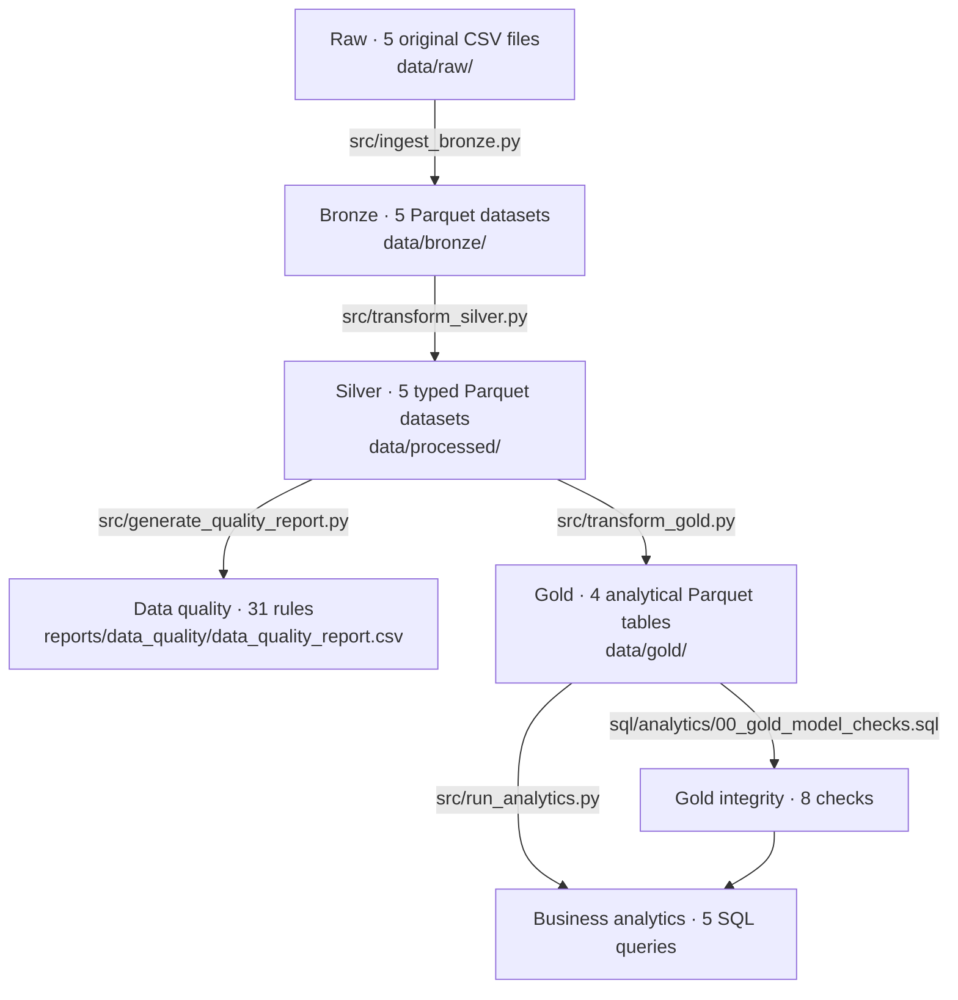
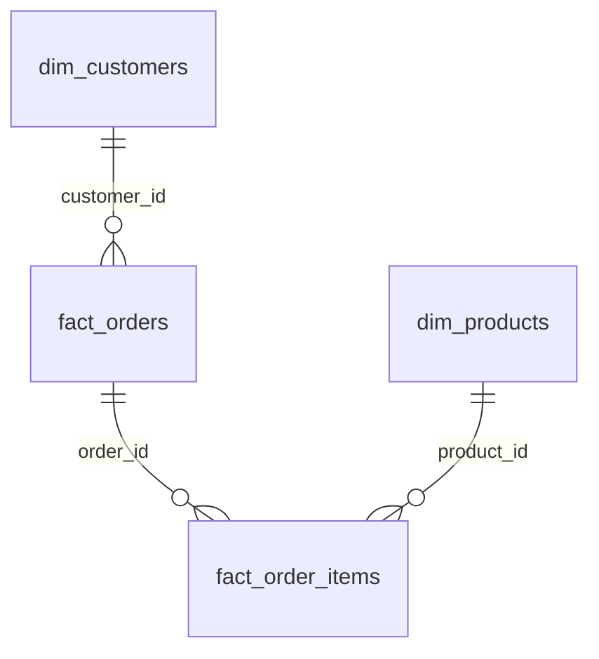
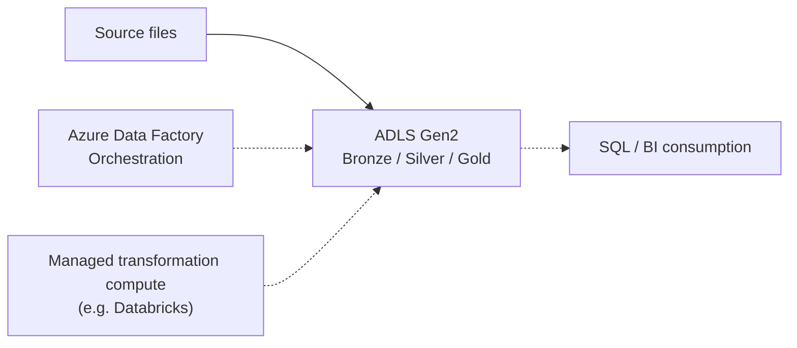

# Retail Data Platform — Architecture

## 1. Overview

Retail Data Platform is a **locally implemented** data engineering and analytics project built with **Python, DuckDB, SQL, and Parquet**. It processes five datasets from the historical Brazilian Olist e-commerce dataset and applies a layered **Raw → Bronze → Silver → Gold** architecture.

The implemented pipeline can be run with one command from the repository root:

```bash
python src/run_pipeline.py
```

This is a local implementation. **Azure is a documented target architecture, not an operating dependency or a tested deployment.**

## 2. Implemented data flow



`src/run_pipeline.py` orchestrates the five execution stages in this order:

1. **Bronze ingestion:** read the source CSVs and write Parquet, retaining source-style columns and reading field values as strings. Each output row count is compared with its input CSV.
2. **Silver transformation:** read Bronze Parquet, normalize basic text fields, cast dates/numeric attributes, and write typed Parquet. Each output row count is compared with its Bronze input.
3. **Data quality and reporting:** execute 31 rules, print statuses, and write a CSV report. Rules of severity `ERROR` fail the stage when violations are found; `WARNING` rules are reported but do not stop the pipeline.
4. **Gold modelling:** generate four analytical tables from the Silver layer and verify model grain/count expectations.
5. **Gold integrity and analytics:** run eight Gold integrity checks, then five SQL analyses. Nonzero integrity issue counts fail execution.

The runner stops when a stage exits unsuccessfully. Its success message means all five stages completed for the **current local dataset snapshot**; it is not a guarantee of production-grade error recovery.

## 3. Dataset inventory

| Source CSV in `data/raw/` | Bronze / Silver Parquet basename | Gold usage |
|---|---|---|
| `olist_orders_dataset.csv` | `orders.parquet` | `fact_orders`, order-level attributes |
| `olist_order_items_dataset.csv` | `order_items.parquet` | `fact_order_items`, aggregated order values |
| `olist_products_dataset.csv` | `products.parquet` | `dim_products` |
| `olist_customers_dataset.csv` | `customers.parquet` | `dim_customers` |
| `product_category_name_translation.csv` | `product_category_name_translation.parquet` | English labels in `dim_products` |

The local processed Silver directory is named **`data/processed/`** for historical compatibility. Conceptually, it is the Silver layer.

## 4. Gold model and analytical grain

| Gold table | Grain | Key |
|---|---|---|
| `fact_orders` | One row per order | `order_id` |
| `fact_order_items` | One row per order item | (`order_id`, `order_item_id`) |
| `dim_products` | One row per product | `product_id` |
| `dim_customers` | One row per customer record | `customer_id` |



**Grain matters:** use `fact_orders` for order counts, order-level recorded amounts, and delivery metrics. Use `fact_order_items` for article/category value analyses. Joining order-level amounts to multiple item rows without controlling the grain would multiply those amounts.

The monetary metrics represent **recorded item and freight amounts**, not audited revenue, net profit, or confirmed cash receipts. The five source datasets do not provide all payment, refund, and return information required for those claims. Some order records have no associated item rows and therefore have zero recorded item amounts in the model.

## 5. Data quality and known observations

The most recent verified local run of the five-dataset quality checks produced:

| Status | Number of rules |
|---|---:|
| PASS | 26 |
| WARNING | 5 |
| FAIL | 0 |

The reported warnings were:

| Rule | Observation | Problem count | Unit |
|---|---|---:|---|
| DQ-006 | Delivered orders without customer delivery timestamp | 8 | Rows |
| DQ-007 | Carrier timestamp earlier than approval timestamp | 1,359 | Rows |
| DQ-008 | Customer delivery timestamp earlier than carrier timestamp | 23 | Rows |
| DQ-019 | Products without category | 610 | Rows |
| DQ-022 | Product categories without English translation | 2 | Distinct categories |

These are **observations from a historical source snapshot**, not automatically corrected values. Counts across rules are not additive because the same record may trigger several rules. Rule definitions and count semantics are explained in [`data-quality-rules.md`](data-quality-rules.md).

The Gold integrity stage checked eight conditions, including uniqueness, referential integrity, and agreement between item amounts and order aggregates (within a defined tolerance). The verified run reported zero issues for all eight checks.

## 6. Business analytics

Reusable SQL is stored under `sql/analytics/`:

- `00_gold_model_checks.sql` — Gold integrity checks.
- `01_monthly_order_value.sql` — Monthly recorded order amounts.
- `02_top_product_categories.sql` — Product-category value and freight.
- `03_customer_states.sql` — Geographic distribution of delivered orders.
- `04_monthly_delivery_performance.sql` — Delivery lead times and late deliveries.
- `05_order_status_overview.sql` — Order statuses and orders without recorded items.

The queries cover **historical** data. The recorded values are in Brazilian reais (BRL) and should not be described as contemporary commercial performance.

## 7. Repository artifacts and reproducibility

**Versioned code and documentation:** `src/`, `sql/analytics/`, `notebooks/`, and `docs/`.

**Generated data:** `data/bronze/`, `data/processed/`, `data/gold/`, and `reports/data_quality/` are runtime output directories. They should remain excluded from Git (except optional `.gitkeep` files). The raw CSVs are likewise not committed under the current repository policy.

To reproduce the pipeline, a user needs the five original CSV files in `data/raw/`, an appropriate Python environment with the project's dependencies, and:

```bash
python src/run_pipeline.py
```

A successful run produces Bronze, Silver, Gold, the data-quality CSV report, and printed analytics results. See [`local-pipeline.md`](local-pipeline.md) for additional execution details.

## 8. Azure target architecture — not deployed

A potential cloud evolution would replace local paths and execution with cloud storage and managed orchestration. An illustrative design is:



**Actual cloud status:** an Azure resource group, storage account, and container had previously been created for experimentation, but the Azure trial credit expired and the subscription became disabled/read-only (`ReadOnlyDisabledSubscription`). Azure Data Factory and Databricks were **not** provisioned; cloud pipeline execution and data upload were **not** successfully tested. The user chose not to incur Azure costs.

The implemented, demonstrated system is therefore **local**. The target diagram is an architectural proposal, not a claim that Azure services are currently running.

## 9. Current limitations and possible future work

- Pipeline outputs are generated stage by stage; the full five-stage run is **not transactional**. A later failure does not roll back earlier successful stages.
- Row-count equality detects lost/extra rows, but it does not by itself prove every value is unchanged or correct.
- The current tests demonstrate successful execution with the supplied Olist snapshot; comprehensive failure-injection, unit tests, CI/CD, and production monitoring are not yet established.
- The local pipeline is batch-oriented; it does not implement incremental ingestion, scheduling, or streaming.
- Some source anomalies and missing product attributes remain deliberately visible rather than being silently invented or repaired.
- Azure deployment remains outside the scope of the no-cost local implementation.

## 10. Related documents

- [`local-pipeline.md`](local-pipeline.md) — Pipeline execution.
- [`data-quality-rules.md`](data-quality-rules.md) — Validation rule catalogue.
- [`data-dictionary.md`](data-dictionary.md) — Dataset columns and relationships.
- [`gold-analytics.md`](gold-analytics.md) — Gold definitions and SQL analysis.
